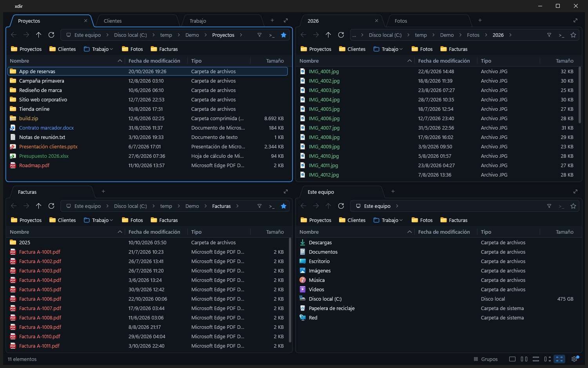

<div align="center">

# xdir

**Tu espacio. Tus reglas.**

Explorador de archivos multipanel para Windows y macOS: hasta cuatro paneles con pestañas y
favoritos, nativo, liviano y con diseño propio.

[](https://github.com/Runick93/xdir/releases/latest)


[**Descargar**](https://github.com/Runick93/xdir/releases/latest) · [Wiki](https://github.com/Runick93/xdir/wiki) · [Reportar un problema](https://github.com/Runick93/xdir/issues/new/choose)



</div>

## Qué es

Para quien trabaja con muchas carpetas a la vez: copiar entre proyectos, ordenar descargas o
revisar facturas y fotos sin abrir diez ventanas del Explorador.

- **Hasta cuatro paneles**, cada uno con sus pestañas, que se arrastran de un panel a otro.
- **Favoritos y grupos** para volver a tu espacio de trabajo con un clic.
- **Salto rápido y paleta de comandos** (`Ctrl+P`, `Ctrl+Shift+P`): todo se encuentra escribiendo.
- **Cuatro vistas**, miniaturas reales, colores por tipo de archivo y temas claro y oscuro.
- **Operaciones del sistema**: en Windows, el mismo progreso, conflictos y menú contextual del
  Explorador; en macOS, copias con clonado APFS, Papelera, Abrir con, Obtener información y QuickLook.
- **Nativo y liviano**: un solo `.exe` de 1,6 MB en Windows (abre en ~127 ms) y una app universal
  para Apple Silicon e Intel en macOS. Sin .NET ni Electron.

Todas las funciones, atajos y opciones están en la [wiki](https://github.com/Runick93/xdir/wiki).

## Instalación

Bajá la última versión desde [Releases](https://github.com/Runick93/xdir/releases/latest):

**Windows**

- **Instalador** (`xdir-<versión>-setup.exe`): se instala en Program Files, con accesos directos.
- **Portable** (`xdir-<versión>-portable.zip`): descomprimí y listo; la configuración queda junto al `.exe`.

**macOS**

- **Imagen de disco** (`xdir-<versión>-macos.dmg`): abrila y arrastrá xdir a Aplicaciones.
- La configuración queda en `~/Library/Application Support/xdir`. En macOS los atajos usan ⌘ donde
  en Windows va Ctrl (⌘T pestaña nueva, ⌘⌫ a la Papelera, ⌘⇧. ocultos).
- Si la versión no está notarizada, la primera vez abrila con clic derecho → Abrir.

xdir avisa cuando hay una versión nueva y se actualiza desde «Acerca de xdir».

## Colaborar

xdir está en desarrollo activo y toda ayuda es bienvenida:

- **Probalo y contanos:** si algo falla o te falta algo, abrí un [issue](https://github.com/Runick93/xdir/issues/new/choose). Hay un formulario para errores y otro para sugerencias.
- **Sumá código:** hacé un fork, creá una rama y mandá un pull request. Para cambios grandes, abrí antes un issue y lo charlamos.

Para compilarlo necesitás Rust (`rustup`).

En **Windows**, además, Visual Studio Build Tools con el Windows SDK:

```bat
scripts\build.cmd                                  :: compilar
scripts\build.cmd run --release -p xdir-windows    :: compilar y ejecutar
scripts\build.cmd test --release                   :: correr los tests
```

El ejecutable queda en `target\release\xdir-windows.exe` (los paquetes lo copian como `xdir.exe`).

En **macOS**, las herramientas de línea de comandos de Xcode (`xcode-select --install`):

```sh
cargo run --release -p xdir-mac  # compilar y ejecutar
cargo test                       # correr los tests
sh scripts/package-mac.sh        # xdir.app universal y el .dmg en dist/
```

Desde una Mac también se puede verificar que la versión de Windows compile:
`rustup target add x86_64-pc-windows-msvc && cargo check --target x86_64-pc-windows-msvc`.

El proyecto es un workspace de tres crates:

- `crates/xdir-core`: todo lo que no depende del sistema (la aplicación, el dibujo, la lista, los paneles, las pestañas,
  el árbol, la paleta, xtree, la configuración y la sesión). No tiene dependencias ni código de sistema en producción: pide
  lo que necesita (ventana, dibujo, archivos, shell, íconos, miniaturas…) mediante traits.
- `crates/xdir-windows`: el binario `xdir-windows`. Ventana Win32, Direct2D, Shell, MFT, accesibilidad (UIA) y los
  recursos de `build.rs`.
- `crates/xdir-mac`: el binario `xdir-mac`. AppKit, Core Graphics, `getattrlistbulk` y `notify`.

Las crates de plataforma son adaptadores finos: implementan los traits del núcleo y arman la ventana, nada más.
Cada una compila vacía (un `main` que avisa y sale) fuera de su sistema, así `cargo build` y `cargo test` andan
en Windows, macOS y Linux.
