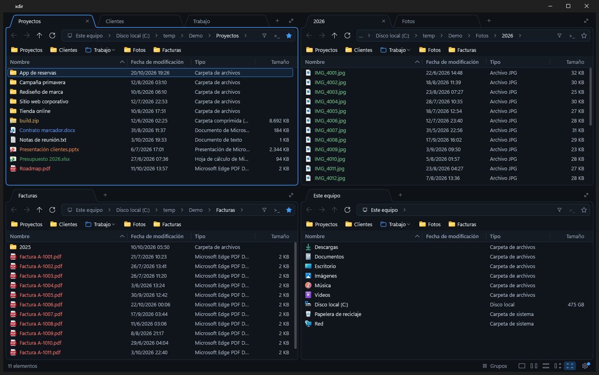

<div align="center">

# xdir

**Tu espacio. Tus reglas.**

Explorador de archivos multipanel para Windows: hasta cuatro paneles con pestañas y favoritos,
nativo, liviano y con diseño propio.

[](https://github.com/Runick93/xdir/releases/latest)


[**Descargar**](https://github.com/Runick93/xdir/releases/latest) · [Wiki](https://github.com/Runick93/xdir/wiki) · [Reportar un problema](https://github.com/Runick93/xdir/issues/new/choose)



</div>

## Qué es

Para quien trabaja con muchas carpetas a la vez: copiar entre proyectos, ordenar descargas o
revisar facturas y fotos sin abrir diez ventanas del Explorador.

- **Hasta cuatro paneles**, cada uno con sus pestañas, que se arrastran de un panel a otro.
- **Favoritos y grupos** para volver a tu espacio de trabajo con un clic.
- **Salto rápido y paleta de comandos** (`Ctrl+P`, `Ctrl+Shift+P`): todo se encuentra escribiendo.
- **Cuatro vistas**, miniaturas reales, colores por tipo de archivo y temas claro y oscuro.
- **Operaciones del Explorador**: mismo progreso, conflictos y menú contextual completo.
- **Nativo y liviano**: un solo `.exe` de 1,6 MB, abre en ~127 ms. Sin .NET ni Electron.

Todas las funciones, atajos y opciones están en la [wiki](https://github.com/Runick93/xdir/wiki).

## Instalación

Bajá la última versión desde [Releases](https://github.com/Runick93/xdir/releases/latest):

- **Instalador** (`xdir-<versión>-setup.exe`): se instala en Program Files, con accesos directos.
- **Portable** (`xdir-<versión>-portable.zip`): descomprimí y listo; la configuración queda junto al `.exe`.

xdir avisa cuando hay una versión nueva y se actualiza desde «Acerca de xdir».

## Colaborar

xdir está en desarrollo activo y toda ayuda es bienvenida:

- **Probalo y contanos:** si algo falla o te falta algo, abrí un [issue](https://github.com/Runick93/xdir/issues/new/choose). Hay un formulario para errores y otro para sugerencias.
- **Sumá código:** hacé un fork, creá una rama y mandá un pull request. Para cambios grandes, abrí antes un issue y lo charlamos.

Para compilarlo necesitás Rust (`rustup`) y Visual Studio Build Tools con el Windows SDK:

```bat
scripts\build.cmd                  :: compilar
scripts\build.cmd run --release    :: compilar y ejecutar
scripts\build.cmd test --release   :: correr los tests
```

El ejecutable queda en `target\release\xdir.exe`.
